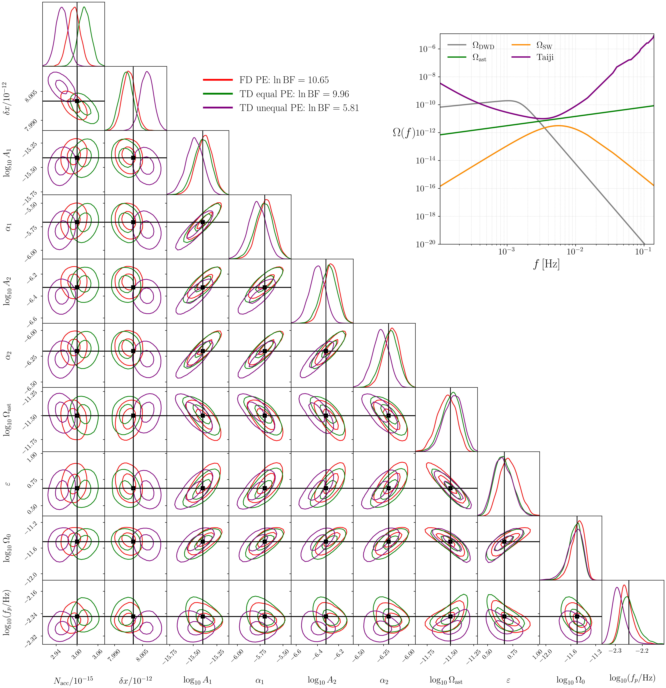

# Figure 8 replay from the authors' archived results

The full ten-parameter corner plot was rendered locally on macOS ARM64 on 2026-11-21. The replay used the unchanged upstream source at `e5ebd75639c3433717ff2cafe52e7f2f5a3f34bb`, the official v1.0.0 archive, and the upstream `--latex` option (TeX Live 2026 and dvipng 1.18). The image has 5039 × 5203 pixels. Its decoded RGB pixels match Figure 8 extracted from the [arXiv v2 PDF](https://arxiv.org/pdf/2608.11276v2) exactly.



| Configuration | Full fit | Null fit | Archived ten-parameter samples | ln Bayes factor |
| --- | --- | --- | ---: | ---: |
| Static equal-arm FD | fit_079 | fit_078 | 5664 | 10.65 |
| Equal-arm TD | fit_081 | fit_080 | 5921 | 9.96 |
| Unequal-arm TD | fit_083 | fit_082 | 5743 | 5.81 |

The run verified the 14 archive parts and the full archive SHA-256, unpacked 4484 files, and verified 4502 input and vendored-source hashes. The upstream replay rendered 15 figures and five tables in 64.5 seconds, after download and unpacking. Cell 43 took 7.5 seconds. The upstream status was `PASS_WITH_DOCUMENTED_DIFFERENCES` with seven documented Table 4 SNR rounding differences and zero unexpected differences. Figure 8 uses the authors' existing posterior and evidence files. Fresh sampling is a separate stage.

From the repository root, with the [local environment](../../../environments/taiji-sgwb-time-domain/README.md), LaTeX, and dvipng available, run:

```sh
run=runs/taiji-sgwb-time-domain/figure-8-repeat
scripts/reproduction/taiji-sgwb-time-domain/replay-figure-8.sh "$run"
environments/taiji-sgwb-time-domain/.venv/bin/python \
  scripts/reproduction/taiji-sgwb-time-domain/audit-figure-8.py "$run/outputs"
```

Choose a fresh run directory for subsequent replays. The runner calls the original `get_data.py` and `reproduce.py all --latex`. The upstream [figure-to-code map](../../../external/taiji-sgwb-time-domain/reference/figure_code_map.json) identifies cells 41 and 43 as the Figure 8 producers.

- [Initial archive download](get_data.txt) and [cached archive verification](replay-data.txt)
- [LaTeX replay log](replay.txt) and [upstream verification report](verification.json)
- [Figure and six-input provenance](figure-8-provenance.json) and [ten-parameter recovery table](table_5.csv)
- [Pinned archive manifest](../../../external/taiji-sgwb-time-domain/data/releases.json)
